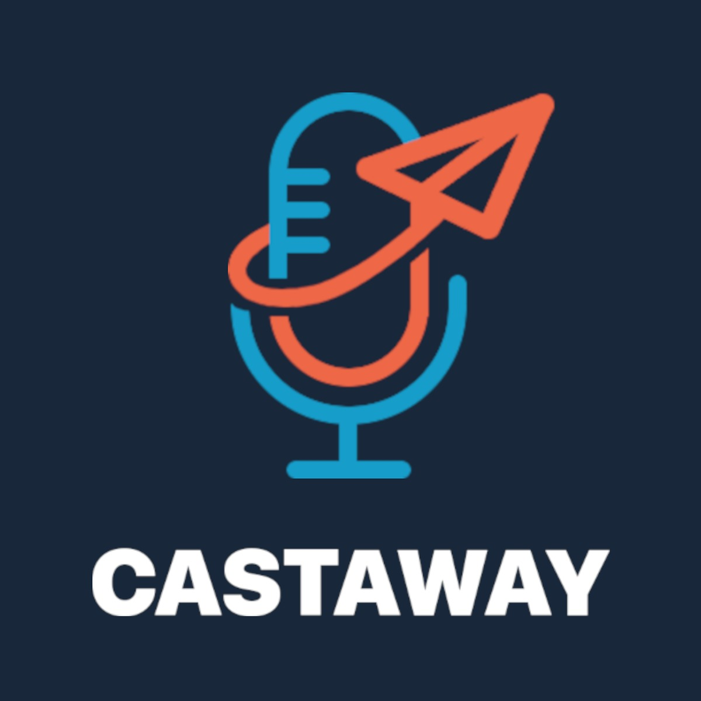

<p align="center">
  
</p>

<h1 align="center">Castaway</h1>

<p align="center">
  <em>Self-hosted podcasts for your whole household.</em>
</p>

<p align="center">
  <a href="LICENSE"></a>
</p>

---

## What is Castaway?

**Castaway is a self-hosted podcast manager.** You run one server, everyone in your
household connects to it, and each person's subscriptions, listening progress, queue and
downloads follow them between devices, because everything lives in your own database.
Listen in the browser, on the desktop, or on your phone.

- **Self-hosted and open source.** Your podcasts and listening data stay on your hardware.
- **Multi-user.** One server for the whole family, each person with their own library,
  stats and settings.
- **Apps everywhere.** Web, Linux, Windows, macOS, Android and iOS.
- **Bring your own apps.** A built-in gpodder-compatible sync server lets you keep using
  AntennaPod and similar apps alongside Castaway.
- **36 languages.**

Castaway is based on [PinePods](https://github.com/madeofpendletonwool/PinePods). See
[Credits & licensing](#credits--licensing).

## Highlights

| | |
|---|---|
| **Listen** | Audio **and video** podcasts, variable speed, chapters, transcripts, downloads, a persistent queue, serial auto-play and per-podcast auto-download. |
| **Organize** | Subscriptions, smart and manual playlists, saved episodes, favorites, full history, and podcasts from local files. |
| **Discover** | Search Podcast Index and iTunes, search inside your own library, and follow podcast hosts. |
| **Sync & apps** | Built-in **gpodder server** (AntennaPod and others), OIDC single sign-on, MFA, and web, desktop and mobile apps with CarPlay and Android Auto. |
| **Make it yours** | Built-in themes plus a custom theme creator, listening stats, OPML import and export, and push notifications (ntfy or webhook). |

## Quick start

Castaway runs as a single container: the web app, the server and its PostgreSQL database are
all inside the image (`ghcr.io/sc00tz/castaway`, built by GitHub for x86_64 and ARM64). On
your Docker host:

```bash
mkdir castaway && cd castaway
curl -fsSLO https://raw.githubusercontent.com/Sc00tz/Castaway/main/docker-compose.yml
curl -fsSL https://raw.githubusercontent.com/Sc00tz/Castaway/main/.env.example -o .env
# edit .env: set CASTAWAY_URL and DATA_DIR
docker compose up -d
```

Then open your `CASTAWAY_URL` and create your first admin account. To update later:
`docker compose pull && docker compose up -d`.

Everything Castaway keeps is in `DATA_DIR`: `postgres/` (the database), `downloads/` and
`backups/`. Back up that folder and you've backed up Castaway.

To use a PostgreSQL server you already run instead of the built-in one, set `DB_HOST`,
`DB_PORT`, `DB_USER`, `DB_PASSWORD` and `DB_NAME` on the container.

## Apps

The web app is served by the server itself: browse to your server's address. The Android,
iOS and desktop apps aren't published to any store yet. Build them from
[`mobile/`](mobile) (Flutter) and [`web/src-tauri`](web/src-tauri) (Tauri).

## Contributing

Bug reports and ideas go in the
[issue tracker](https://github.com/Sc00tz/Castaway/issues). See
[CONTRIBUTING.md](CONTRIBUTING.md) for development setup.

## Credits & licensing

Castaway is licensed under the **GNU General Public License v3.0**. See [LICENSE](LICENSE).

Castaway is based on **[PinePods](https://github.com/madeofpendletonwool/PinePods)**,
© Gooseberry Development, also licensed under the GPL-3.0. Thank you to its author and
contributors for the foundation this project is built on.

The mobile app includes code adapted from the
[Anytime Podcast Player](https://github.com/amugofjava/anytime_podcast_player),
© 2020 Ben Hills and contributors, licensed under the BSD 3-Clause License. Affected files
keep their original license and attribution; see the license files in
[`mobile/`](mobile).
