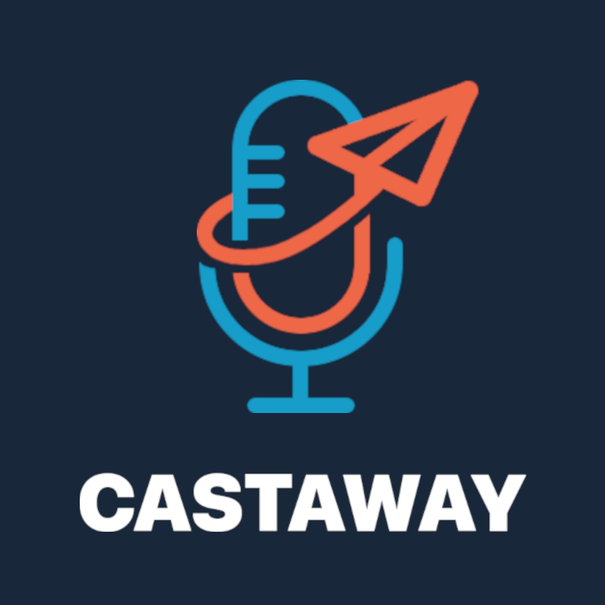

<p align="center">
  
</p>

<h1 align="center">Castaway</h1>

<p align="center">
  <em>Self-hosted podcasts for your whole household.</em>
</p>

<p align="center">
  <a href="LICENSE"></a>
</p>

---

## What is Castaway?

**Castaway is a self-hosted podcast manager.** You run one server, everyone in your
household connects to it, and each person's subscriptions, listening progress, queue and
downloads follow them between devices, because everything lives in your own database.
Listen in the browser, on the desktop, or on your phone.

- **Self-hosted and open source.** Your podcasts and listening data stay on your hardware.
- **Multi-user.** One server for the whole family, each person with their own library,
  stats and settings.
- **Apps everywhere.** Web, Linux, Windows, macOS and Android (the iOS app's code is
  included but not built yet).
- **Bring your own apps.** A built-in gpodder-compatible sync server lets you keep using
  AntennaPod and similar apps alongside Castaway.
- **36 languages.**

Castaway is based on [PinePods](https://github.com/madeofpendletonwool/PinePods). See
[Credits & licensing](#credits--licensing).

## Highlights

| | |
|---|---|
| **Listen** | Audio **and video** podcasts, variable speed, chapters, transcripts, downloads, a persistent queue, serial auto-play and per-podcast auto-download. |
| **Organize** | Subscriptions, smart and manual playlists, saved episodes, favorites, full history, and podcasts from local files. |
| **Discover** | Search Podcast Index and Apple Podcasts, trending shows and categories, suggestions based on what you listen to, search inside your own library, and follow podcast hosts. |
| **Sync & apps** | Built-in **gpodder server** (AntennaPod and others), OIDC single sign-on, MFA, and web, desktop and mobile apps with CarPlay and Android Auto. |
| **Make it yours** | Built-in themes plus a custom theme creator, listening stats, OPML import and export, and push notifications (ntfy or webhook). |

## Castaway and PinePods

Castaway started as a fork of [PinePods](https://github.com/madeofpendletonwool/PinePods) and
keeps most of what it does: the web, desktop and mobile apps, the gpodder sync server,
playlists, stats, themes, OIDC and MFA. These are the main differences (PinePods as of its
November 2026 code):

| | PinePods | Castaway |
|---|---|---|
| **Database** | PostgreSQL or MySQL/MariaDB (SQLite is also supported) | PostgreSQL only |
| **What you run** | The app plus separate database and Valkey/Redis containers (a single container with SQLite) | One container, with PostgreSQL inside it, and one data folder; the database password is generated for you |
| **Valkey / Redis** | Required (except with SQLite) | Not needed |
| **Database setup** | A Python setup tool in the image | The server applies its own migrations; no Python in the image |
| **Podcast search** | Through PinePods' search service (`search.pinepods.online` by default; can be self-hosted) | Your server asks Apple Podcasts and Podcast Index directly. Apple needs no key; Podcast Index uses your own free key, stored on your server |
| **Trending and categories** | Podcast Index, through the search service | Podcast Index with your key, otherwise Apple's charts (works without a key) |
| **Hosts and guests** | Feed tags plus PodPeople DB (`people.pinepods.online`) | Feed tags plus Podcast Index's person search |
| **Podping** (instant new-episode alerts) | Supported, read through PinePods' search service | Not included |
| **YouTube** | Search for channels, and subscribe | Subscribe by a channel's address (no YouTube search) |
| **AI features** | Optional sidecar: Whisper transcription and ad detection | Not included (transcripts published by feeds still work) |
| **Listening position** | Each update replaces the saved position, whichever arrives last | Each position carries the time it was taken, so a late upload from another device can't overwrite newer progress; phone lists update live while you listen |
| **Discover on Android** | Web app | Web app and Android app |
| **Getting the apps** | Flathub, App Store, Google Play, IzzyOnDroid, Obtainium; server image on Docker Hub | GitHub releases (Android APK and desktop apps); server image on GitHub Container Registry; no iOS build yet |
| **Online services used** | PinePods' search, people and news services | None of PinePods' services; only Apple and Podcast Index |

Also changed in Castaway:

- Feed HTML (descriptions, show notes, transcripts) is sanitized when it's stored and when
  it's shown.
- The server refuses to fetch feed-supplied addresses on your internal network, unless you
  allow specific ones with `ALLOWED_PRIVATE_NETWORKS`.
- Single sign-on matches accounts by the provider's user ID; linking by email needs a
  verified email.
- "Hide played" on every episode list, on the web and the phone.
- Downloads on the phone show their progress and can be stopped; removing one also removes
  its saved artwork.

**Moving from PinePods:** Castaway takes over an existing PinePods **PostgreSQL** database as
it is, if it's at PinePods' latest database version (update PinePods first otherwise).
MySQL/MariaDB and SQLite installs would need moving to PostgreSQL first.

**Which to use:** PinePods is the established project, with app-store apps (including iOS),
MySQL/MariaDB and SQLite support and the AI features. Castaway is for running one simple
container with PostgreSQL, without depending on PinePods' online services.

## Quick start

Castaway runs as a single container: the web app, the server and its PostgreSQL database are
all inside the image (`ghcr.io/sc00tz/castaway`, built by GitHub for x86_64 and ARM64). On
your Docker host:

```bash
mkdir castaway && cd castaway
curl -fsSLO https://raw.githubusercontent.com/Sc00tz/Castaway/main/docker-compose.yml
curl -fsSL https://raw.githubusercontent.com/Sc00tz/Castaway/main/.env.example -o .env
# edit .env: set CASTAWAY_URL and DATA_DIR
docker compose up -d
```

Then open your `CASTAWAY_URL` and create your first admin account. To update later:
`docker compose pull && docker compose up -d`.

**Search:** Apple Podcasts search, trending shows and categories work right away (without a
Podcast Index key they come from Apple's charts). For Podcast Index search and finding a host's
other shows, get a free API key at [api.podcastindex.org](https://api.podcastindex.org) and
enter it under Settings → Podcast Index. Searches go from your server straight to Apple and
Podcast Index; the key never leaves the server.

Everything Castaway keeps is in `DATA_DIR`: `postgres/` (the database), `downloads/` and
`backups/`. Back up that folder and you've backed up Castaway.

To use a PostgreSQL server you already run instead of the built-in one, set `DB_HOST`,
`DB_PORT`, `DB_USER`, `DB_PASSWORD` and `DB_NAME` on the container.

## Apps

The web app is served by the server itself: browse to your server's address. Every
[release](https://github.com/Sc00tz/Castaway/releases) has the Android app (`.apk`, signed, so
each new one installs over the last) and the desktop apps for Linux (x86_64 and ARM64), macOS
and Windows. They aren't in any app store. The iOS app's code is in [`mobile/`](mobile) but
isn't built or distributed yet.

## Contributing

Bug reports and ideas go in the
[issue tracker](https://github.com/Sc00tz/Castaway/issues). See
[CONTRIBUTING.md](CONTRIBUTING.md) for development setup.

## Credits & licensing

Castaway is licensed under the **GNU General Public License v3.0**. See [LICENSE](LICENSE).

Castaway is based on **[PinePods](https://github.com/madeofpendletonwool/PinePods)**,
© Gooseberry Development, also licensed under the GPL-3.0. Thank you to its author and
contributors for the foundation this project is built on.

The mobile app includes code adapted from the
[Anytime Podcast Player](https://github.com/amugofjava/anytime_podcast_player),
© 2020 Ben Hills and contributors, licensed under the BSD 3-Clause License. Affected files
keep their original license and attribution; see the license files in
[`mobile/`](mobile).
